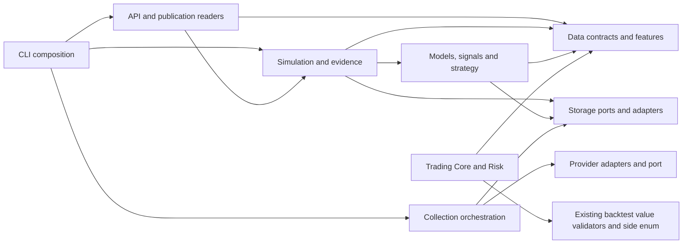

# Modular architecture baseline

This is a modular-monolith dependency baseline for existing Python code, not a
functional rewrite. Production files, REST/CLI contracts, schemas, decisions,
execution economics, approvals and historical hashes are unchanged.

Inspected base: `8c84e0f36bb993cdd711271b43f7f9cacb5043e8` (PRs #120, #121 and
#122 merged). The inspection covers every production `.py` under
`src/donghak_stock_vision`, including module/function-local imports, type-only
imports, optional imports and package initializers. Source is parsed, never
imported to discover dependencies. Counts below describe this base, not a frozen
list of the only modules future tests are permitted to inspect.

## Current responsibilities and public interfaces

| Physical area | Python files | Current responsibility and stable interfaces |
| --- | ---: | --- |
| root | 11 | Version, `__main__`, CLI dispatch and dedicated command adapters |
| `api` | 33 | FastAPI transport/DTOs, immutable publication readers, comparison, operations, metadata, PIT/qualification/reviewer gates |
| `backtest` | 58 | Frozen contracts, simulation runners, admission/execution, shared account ledger, reports, archives, official evidence and acquisition/review CLIs |
| `config` | 2 | Application environment/settings composition |
| `data` | 6 | KRX schema, exact learning contracts, research calendars/splits, frozen snapshot capture |
| `features` | 2 | Pure OHLCV feature/segment calculations |
| `ingestion` | 3 | Provider/store collection orchestration and validation |
| `models` | 8 | Research training/evaluation, score-only linear/HGB inference and pinned local artifact resolver |
| `providers` | 5 | Market data port, fake mechanics and KRX/HTTP adapters |
| `signals` | 7 | Signal values, dataset building, research inference integration and AnalysisStore publication |
| `storage` | 24 | MarketDataStore protocol, SQLite/Analysis/Decision stores, custody/evidence transport and integrity contracts |
| `strategy` | 5 | Immutable decision inputs/policies/results, pure decision engine and read-only assembly adapter |
| `trading` | 4 | KR/US broker-neutral values, paper-only broker ports and deterministic risk evaluator |
| `validation` | 2 | Market bar normalization/invariants |

Total: **170 production Python files**. Package names describe history rather
than complete architectural separation: `backtest` contains accounting and
acquisition; `api` contains governance and readers; `storage` contains pure
custody values alongside implementations. These are confirmed colocations, not
proof that their current behavior is wrong.

Installed console scripts remain:

| Command | Existing callable |
| --- | --- |
| `dsv` | `donghak_stock_vision.cli:main` |
| `dsv-api` | `donghak_stock_vision.api_cli:main` |
| `dsv-portfolio-publication` | `donghak_stock_vision.portfolio_publication_cli:main` |
| `dsv-api-export` | `donghak_stock_vision.api_export_cli:main` |

`python -m donghak_stock_vision` dispatches the same `dsv` main. Learning,
decision, backtest and historical CLI modules supply existing delegated
subcommands; they are not newly exposed services. `security_metadata_cli` and
existing evidence collection/review/verification module guards remain usable.
Existing explicit `python -m donghak_stock_vision.backtest.<module>` guards are:
`collect_dart`, `collect_corporate_action_documents`, `dart_document_batch`,
`dart_batch_orchestrator`, `dart_multi_batch_session`, `inspect_evidence`,
`package_evidence`, `review_corporate_action_documents`, `verify_dart`,
`verify_official`, `verify_security_lifecycle`, `verify_runner_tail`,
`verify_corporate_action_acquisition` and
`verify_corporate_action_semantic_review`. Architecture checks do not invoke
these collection/review commands or grant permission to do so.

The tests statically resolve all current `pyproject.toml` console callables; they
do not execute evidence acquisition commands for architecture inspection.

Existing interfaces to preserve include `DailyBar`, `MarketDataStore`,
`ScoreModel`, signal/Decision contracts, `VirtualOrder`/`VirtualFill`, Ledger
checkpoints, frozen shared evidence, Position History/Performance, compact
receipt archives, trusted publication reader/index/pins, `ResearchAPIReader`,
Trading Core and `evaluate_risk`. No broad shared `core` package is introduced.

## Observed dependency map

The AST inventory records **1,432 explicit import edges** including standard
library and optional/local/type-only imports. An edge is one resolved target per
import statement, not the number of individual imported symbols. Full symbol
lists remain part of the exception identity.

This is a readable aggregation, not an assertion that each box is a separate
service or a complete acyclic layer. `models` and `signals` refer to each other
at package level; that alone does not establish a module import failure.
`data.snapshot` depends on `storage.base`, which is a **protocol**, not a database
adapter. Likewise `providers.base` is a port. Do not count those ports as concrete
infrastructure merely because of their directory names.

## Confirmed imports and target-relative debt

The live scan finds **48 domain-direction occurrences** against the proposed
matrix below and **4 direct SQLite capability imports** in domain-classified
modules. These are confirmed source facts relative to a chosen target boundary;
they are not evidence of incorrect P&L, broken approval gates or runtime bugs.
Exact imports, symbols, aliases, lexical scopes, type/deferred flags, counts and
migration rationale are recorded in [architecture-debt.json](architecture-debt.json).

Representative debt:

- `ingestion.market` directly names `KRXProvider`; ingestion pipelines catch
  `sqlite3.Error`, coupling orchestration/error handling to implementation.
- `models.service`, `models.experiment`, `signals.service`, historical services
  and portfolio orchestration depend on concrete `AnalysisStore` owners.
- `strategy.adapter` is correctly recognized as an adapter; `decision_bridge`
  combines pure admission with DecisionStore/assembly/strategy orchestration.
- Core-marked `backtest.data` combines immutable `FrozenJSON` with reconstruction
  methods pointing back into shared evidence and historical execution.
  `entry_contract` combines authored intent values and higher-level preflight.
- `signals.domain` imports score contracts from `models.inference`, which also
  owns inference implementation. Extracting the value declarations later can
  reduce that coupling without duplicating them now.
- Accounting proof/report code references execution and strategy verification.
  Archive `receipt_validation` invokes authoritative simulation/replay validators.
  Never resolve that debt by deleting replay or weakening proof validation.
- `run_evidence` and `storage.capture_raw_source_contract` directly import SQLite;
  a contract-looking filename does not automatically make its implementation
  infrastructure-free.

The graph also records **55 static runtime-cycle-edge occurrences**. Function
imports are marked deferred, and implicit child → package-initializer edges are
included in reachability. Type-only links are retained in inventory but excluded
from runtime-cycle reachability. Thus this count is **not 55 failing imports**:

- `api.__init__` eagerly re-exports `create_app`. Importing API DTO/readers also
  traverses that initializer, coupling them to the application import graph.
- FrozenJSON/shared-evidence/historical/availability modules have mutual paths,
  several intentionally deferred to reconstruction properties.
- Account execution frames and Performance verification have mutual references;
  portfolio runner/report ownership has a deferred return path.
- DART collection/session/CLI helpers have mutual static paths with local imports.

The exact cycle edges are separately grandfathered, not a wildcard for an
existing strongly connected component: a new edge within an old cycle fails.
Breaking these paths needs compatibility/import regressions, not automatic file
moves in this PR. No runtime failure was manufactured by importing acquisition
or operational modules to test the graph.

## Logical target boundaries and allowed directions

These are logical ownership labels on existing paths. They need not become nine
physical packages. `tests/architecture/checks.py` contains the executable mapping
and allowed matrix. Composition/adapters are recognized explicitly, not inferred
from merely adding a `__main__` block.

| Owner | Allowed local dependencies |
| --- | --- |
| Core Contracts | Core Contracts only |
| Market Data | Core Contracts, Market Data |
| Research & Strategy | Core Contracts, Market Data, Research & Strategy, Governance & Evidence |
| Simulation & Backtesting | Core Contracts, Market Data, Research & Strategy, Simulation, Portfolio & Accounting, Risk & Execution, Governance & Evidence |
| Portfolio & Accounting | Core Contracts, Market Data, Portfolio & Accounting, Governance & Evidence |
| Risk & Execution | Core Contracts, Market Data, Portfolio & Accounting, Risk & Execution, Governance & Evidence |
| Governance & Evidence | Core Contracts, Governance & Evidence |
| Infrastructure Adapters | Any domain/port or other adapter, excluding Application |
| Application / API / CLI | All domains; compose owners and inject adapters |

Core includes existing data/decision/intent values and pure ports
(`storage.base`, `providers.base`). Accounting labels the existing Ledger,
Position History, Performance and baseline book/costs. Risk labels Trading ports
and evaluator plus existing shared execution/admission orchestration. Evidence
labels immutable archive/shared evidence, replay proof and governance modules.
Specific existing acquisition CLI owners and transports are classified as
Application/Infrastructure, not treated as pure merely because they reside in
`backtest`. API governance colocations still live at the Application boundary;
separating their domain logic is later work.

Core and domain layers cannot import FastAPI/Pydantic, DB, HTTP/cloud or broker
implementations. New external dependencies are rejected in domain layers; only
existing learning-library families are allowed for Research. Stdlib networking
(`socket`, `urllib.request`, `http.client`) is also classified as infrastructure.
Application and adapter modules may use their infrastructure dependencies.

Contracts named `contracts`, `domain`, `schema` or `*_contract` receive the Core
rule even in an existing package. New physical top-level packages must get an
explicit classification. New modules under known domains inherit their rules;
there is no allowlist of only the old 170 files to scan.

## Verification and limitations

Run `pytest -q tests/architecture` using the existing offline pytest tooling.
The checker uses only stdlib AST/path/JSON tools; no new dependency is needed.
It resolves absolute/relative imports, aliases, `from package import submodule`,
function/class scopes, conventional TYPE_CHECKING aliases/branches, and literal
`importlib.import_module` / `__import__` calls. Recognized nonliteral dynamic
loads fail for review instead of being ignored. Package initializers participate
in cycle detection. Duplicate module identities and syntax errors fail analysis.

Legacy exceptions bind the **complete import AST**, target, source module,
lexical scope, type-only/deferred flags and occurrence count. Line numbers are
only diagnostics, allowing harmless line moves. Changed symbols or aliases,
duplicate occurrences, a new file or a new cycle edge do not reuse an exception.
Removed debt produces a stale-exception error so cleanup is explicit.
There is no baseline auto-update step in tests. Any policy or debt-file change
requires review; do not add exceptions just to obtain a green test.

This is a deterministic source dependency guard, not a security sandbox, Python
execution tracer or proof of absence of I/O. It does not analyze arbitrary
reflection, aliases assigned through runtime data flow, custom loaders, generated
source, entrypoint plugins or dependencies hidden behind opaque strings outside
recognized import calls. Branch conditions are conservatively scanned, not
executed. New known imports are checked even under TYPE_CHECKING. Stdlib file
helpers are not categorically prohibited. Reviewed debt remains visible and
permitted so existing behavior alone does not fail CI.

## Compatibility-preserving migration and next steps

1. Extract narrow value/port declarations from mixed modules only when a concrete
   consumer requires it. Keep old import paths as compatibility re-exports;
   retain canonical schemas, source IDs and report/economic hashes.
2. Move composition outward and inject existing MarketDataStore/analysis/verifier
   ports before relocating implementation. Reduce exact debt entries as imports
   disappear; never weaken a proof validator to satisfy an architecture test.
3. For Paper Broker, preserve the paper-only port and full-order RiskDecision
   binding. Add explicit durable idempotency, current revision checks, atomic
   reservations and evidence freshness in a separate reviewed adapter/application
   PR. Keep funding, reconciliation and receipt validation authoritative. This
   baseline neither supplies a broker nor authorizes execution.
4. For Mass Simulation, compose frozen input providers, the existing runner,
   shared Ledger, Risk preflight and compact evidence output through an
   application service. Add bounded synthetic batches and equivalence/resource
   measurements later. Reuse inference/artifact contracts instead of introducing
   another model object or economic ledger. No simulation batch runs here.
5. Separate API initialization and reader/DTO import ownership with import smoke
   coverage; maintain `from donghak_stock_vision.api import create_app` and all
   existing published responses. Revisit mixed governance/application owners
   without moving qualification semantics into display DTOs.

Overlaps intentionally retained: research `VirtualOrder`/`VirtualFill` versus
generic Trading Core intents/fill descriptions; dictionary Decision inputs
versus typed paper values; KRW historical positions versus KR/US descriptions;
API Pydantic wire DTOs versus domain records; FrozenJSON/Document serialization
owners. Similar field names do not establish interchangeable meanings. Do not
unify them by silently broadening historical execution or evidence contracts.

Protected Market/Analysis DBs, DART/KRX/Security Metadata, frozen datasets/model
checkpoints, OOS/qualification/approval evidence, Operations state and PIT/
Corporate Actions/Runner Tail/Run Input Freeze restrictions remain unchanged.
No financial API or broker calls are needed. Existing Python 3.13, macOS X64
self-hosted CI and its workflow remain unchanged. Full offline regression remains
in CI; this task does not inspect or wait for its status.
